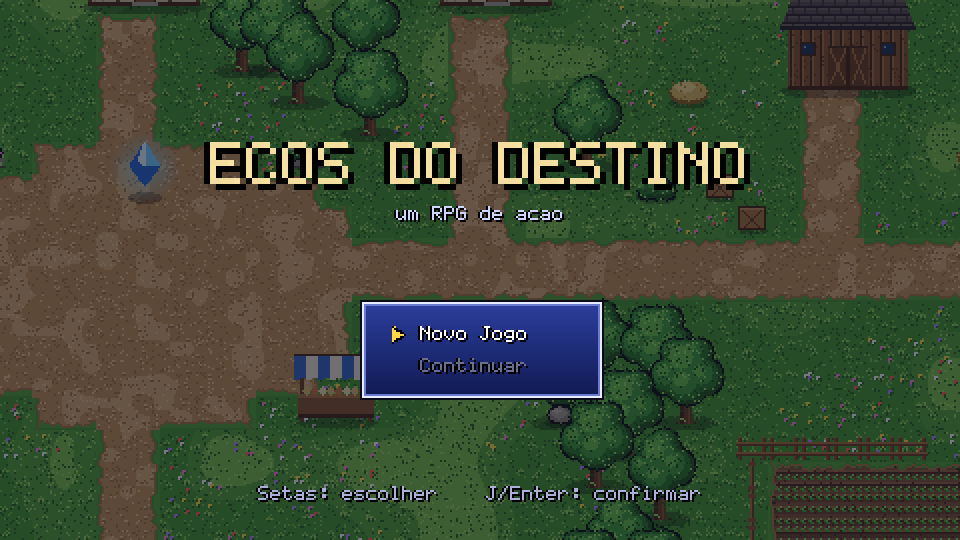
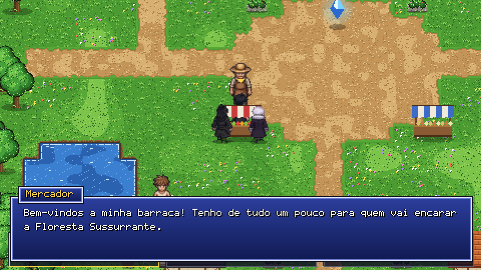
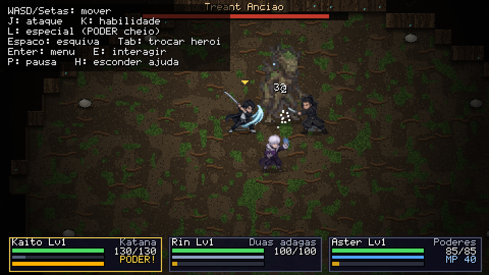
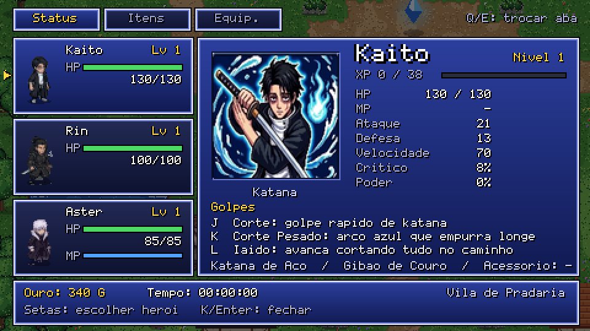
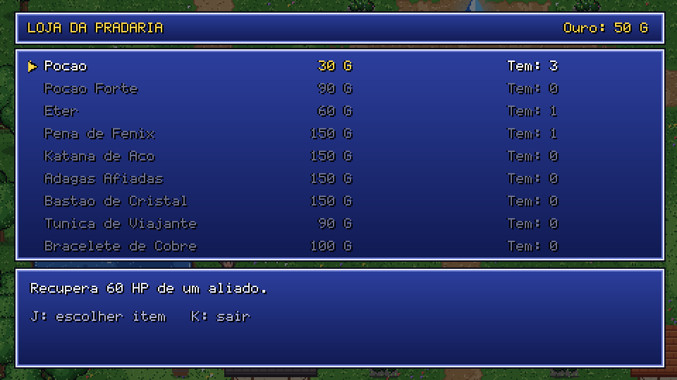

# My RPG — Ecos do Destino

> **[PT-BR]** RPG de ação estilo SNES (16-bit) construído inteiramente com **JavaScript puro (ES Modules) e Canvas 2D**, sem frameworks, sem engines externas e sem etapa de build. Criado como um **projeto prático para estudar e visualizar os conceitos fundamentais de frontend** (ciclo de renderização em tempo real, arquitetura modular, separação entre estado puro e interface, manipulação de pixels em buffers, persistência versionada no navegador e testes automatizados nativos).
>
> **[EN]** A 16-bit SNES-style Action RPG built entirely with **Vanilla JavaScript (ES Modules) and HTML5 Canvas 2D** — zero frameworks, zero game engines, and zero build step. Designed as a **hands-on project to study and visualize core frontend engineering concepts** (real-time render loops, modular architecture, pure state vs. UI separation, pixel buffer manipulation, versioned browser persistence, and native automated testing).

🎮 **Demo Online / Playable Demo:** [https://nes-62ga38git-lpazzims-projects.vercel.app/](https://nes-62ga38git-lpazzims-projects.vercel.app/)

**Idioma / Language:** [Português (PT-BR)](#sobre-o-projeto-pt-br) | [English (EN)](#english-version)

---

## Capturas de Tela / Screenshots

| Tela Título (`title`) | Exploração & Diálogos (`dialog`) |
| :---: | :---: |
|  |  |
| Câmera panorâmica sobre o mapa pintado por código e tipografia bitmap própria. | Vila de Pradaria, moradores com rotina de passeio, cristal de save e caixa de diálogo estilo SNES. |

| Combate em Tempo Real (`play`) | Menu de Status & Equipamentos (`menu`) |
| :---: | :---: |
|  |  |
| Grupo de 3 heróis (1 controlado pelo jogador + 2 por IA), hitboxes, partículas e HUD. | Retratos em pixel art, atributos calculados com bônus de equipamento e lista de golpes. |

| Sistema de Loja (`shop`) |
| :---: |
|  |
| Compra e venda de consumíveis e peças de equipamento com rolagem e validação pura de estoque/ouro. |

---

## Sobre o Projeto (PT-BR)

**My RPG (*Ecos do Destino*)** é um RPG de ação em tempo real inspirado nos clássicos de 16 bits como *Seiken Densetsu 3* (SNES), com universo, personagens e arte 100% originais.

Mais do que um jogo, este repositório foi desenhado como um **laboratório de engenharia de frontend** para estudar e visualizar como as fundações da web funcionam por baixo dos panos quando removemos abstrações como React, Vue, Phaser, Webpack ou Vite:

1. **Loop de Tempo Real & Delta Time (`requestAnimationFrame`)**:
   - Todo quadro executa um pipeline determinístico de três fases em `src/main.js`: `game.update(dt)` -> `game.render()` -> `game.input.endFrame()`.
   - O cálculo de `dt` (delta time limitado a `0.05s`) garante que física, animações, timers e recargas rodem na mesma velocidade independentemente da taxa de atualização do monitor.
2. **Renderização Canvas 2D & Manipulação de Buffers de Pixels**:
   - Resolução interna fixa de `480x270` (proporção 16:9 estilo pixel art) escalada para a janela com `image-rendering: pixelated` e `ctx.imageSmoothingEnabled = false`.
   - O chão, árvores, casas, cavernas e portais **não usam tilesets prontos**: são pintados pixel a pixel em memória (`Uint8ClampedArray` / `ImageData` em `src/map/art.js`) com ruído determinístico e cacheados em um `<canvas>` offscreen por mapa.
   - Ordenação de profundidade (*Y-sorting*) por quadro combinando heróis, inimigos, NPCs e objetos do cenário.
3. **Tipografia Bitmap Própria (`src/font.js`)**:
   - Em vez de depender de `ctx.fillText` (que aplica anti-aliasing do sistema operacional e deixa as letras borradas ao ampliar o canvas), o projeto desenha cada caractere ASCII numa grade de `5x7` pixels cacheada em atlas por cor, mantendo nitidez absoluta em qualquer resolução.
4. **Arquitetura Modular com ES Modules Nativos & Grafo Unidirecional**:
   - O navegador carrega os módulos diretamente via `<script type="module" src="src/main.js">`.
   - A direção das dependências é estritamente controlada: módulos de base (`data.js`, `items.js`, `equipment.js`, `shop.js`, `dialog-runner.js`, `save.js`) não importam nada de interface nem de `game.js`. Sistemas (`combat-system.js`, `interaction.js`) recebem a instância `game` por parâmetro, evitando acoplamento circular.
5. **Máquina de Estados de UI & Imutabilidade de Atributos**:
   - O orquestrador (`src/game.js`) opera sobre um modo explícito (`title`, `play`, `menu`, `shop`, `save`, `dialog`, `over`), que define quem consome os eventos de teclado e congela o mundo durante interações.
   - Os heróis separam atributos próprios de nível (`baseAtk`, `baseDefense`, `baseSpeed`, `baseCrit`, `baseMaxMp`) dos atributos efetivos expostos por *getters* (`atk`, `defense`...), somando o bônus recalculado em `recalcEquip()`. Equipar ou remover peças nunca corrompe o estado base do personagem.
6. **Separação entre Regras de Negócio Puras e Apresentação**:
   - Regras de compra/venda/descanso (`src/shop.js`), cálculo de equipamentos (`src/equipment.js`), paginação de diálogos (`src/dialog-runner.js`) e fórmulas de dano (`src/combat.js`) são funções puras sem referência a DOM ou Canvas, permitindo execução direta em testes de unidade no Node.js.
7. **Persistência Versionada & Migração de Esquema (`localStorage`)**:
   - Sistema de 3 slots de gravação (`src/save.js`) versionado por `SAVE_VERSION` (atualmente na versão 2), incluindo função de migração automática (`migrateSave`) que atualiza saves antigos da versão 1 sem perda de progresso.
8. **Geração Procedural Determinística (PRNG)**:
   - Os andares das dungeons (`src/maps/dungeon.js`) são gerados a partir de uma semente numérica (`makeRng` em `src/maps/builder.js`), garantindo variedade com layouts 100% reproduzíveis entre sessões e testes.

---

## Stack Tecnológica

| Camada | Tecnologia | Papel no Projeto |
| :--- | :--- | :--- |
| **Motor & UI (Frontend)** | JavaScript Puro (ES2022+ ES Modules) + HTML5 Canvas 2D | Jogo completo no navegador com **zero dependências de runtime** e **sem bundler**. |
| **Servidor Local** | Node.js (`server.js` com `http` e `fs` nativos) | Servidor estático leve na porta `8080`, sem Express ou pacotes externos. |
| **Persistência** | Web Storage API (`localStorage`) | 3 espaços de save no navegador com versionamento e migração automática (`SAVE_VERSION = 2`). |
| **Pipeline de Assets** | Node.js + `sharp` (`devDependency`) | Scripts em `tools/` para recorte automático de quadros, remoção de fundo, escala e quantização de paleta 15-bit SNES. |
| **Testes Automatizados** | `node:test` + `node:assert/strict` (nativos do Node.js) | 124 testes cobrindo regras de negócio, integridade de mapas, conectividade (flood-fill), fontes, diálogos e saves. |

---

## Decisões Arquiteturais

| Decisão | Motivação / Conceito de Frontend Estudado | Alternativa Descartada |
| :--- | :--- | :--- |
| **Vanilla JS (ES Modules) sem build** | Entender o carregamento nativo de módulos do navegador, manter o ciclo de feedback instantâneo (salvar e recarregar) e eliminar complexidade de bundlers. | Frameworks de UI (React/Vue), engines prontas (Phaser/Godot) ou bundlers (Vite/Webpack). |
| **Arte do mapa pintada por código (`PixelBuf`)** | Estudar geração procedural de texturas, manipulação direta de arrays de pixels (`Uint8ClampedArray`) e cache em canvas offscreen, sem depender de licenças de tilesets externos. | Recortar imagens/tilesets estáticos de terceiros. |
| **Fonte bitmap própria (`src/font.js`)** | Evitar o anti-aliasing da fonte do sistema em `ctx.fillText`, que deixa textos borrados ao escalar um canvas de baixa resolução (`480x270`) para tela cheia. | `ctx.fillText` com fontes TTF/WebFonts. |
| **Regras puras desacopladas do Canvas** | Permitir que toda a lógica de combate, loja, diálogos, equipamentos e geração de mapas seja validada em milissegundos via `node:test` sem emular o DOM. | Misturar regras de negócio dentro dos métodos `draw()` ou de eventos de teclado. |
| **Atributos base separados de bônus (`recalcEquip`)** | Evitar bugs clássicos de mutação acumulativa ao equipar/desequipar itens ou subir de nível, mantendo uma única fonte da verdade para os atributos do herói. | Somar e subtrair bônus diretamente nos atributos do herói a cada troca. |
| **Dungeons geradas por semente (PRNG)** | Demonstrar determinismo em frontend: a mesma semente produz exatamente as mesmas salas, corredores, colisões e posições de inimigos, viabilizando testes automatizados de alcançabilidade. | Desenhar cada andar manualmente ou usar `Math.random()` não determinístico. |
| **Pipeline automático de sprites (`tools/build-sprites.js`)** | Padronizar folhas de arte com detecção automática de quadros, conversão de sombra semitransparente, redução 2x e paleta de 15 bits (estilo SNES). | Recorte e alinhamento manual quadro a quadro. |

---

## Como Rodar

Você pode testar a demo publicada online: **[nes-62ga38git-lpazzims-projects.vercel.app](https://nes-62ga38git-lpazzims-projects.vercel.app/)**

Para rodar localmente, precisa apenas do [Node.js](https://nodejs.org) (v18+ recomendado).

```bash
# 1. Instala a devDependency (sharp, usada apenas pelas ferramentas de sprite)
npm install

# 2. Inicia o servidor estático local
npm start
```

Depois abra **http://localhost:8080** no navegador.

### Comandos Disponíveis

```bash
npm start                                        # Servidor local em http://localhost:8080
npm test                                         # Roda os 124 testes automáticos (mapas, conteúdo, regras)
npm run sprites                                  # Converte assets/source/* em assets/sprites/*
npm run sprites -- kaito knight                  # Converte apenas as folhas indicadas
node tools/detect-frames.js kaito previa.png     # Numera os quadros detectados de uma folha para inspeção
npm run skills:sync                              # Sincroniza .agents/skills com .claude/skills
```

---

## Controles

| Tecla | Ação |
| :--- | :--- |
| **WASD / Setas** | Mover o herói líder |
| **J** (segurar) | Ataque básico |
| **K** | Habilidade especial da classe |
| **L** | Especial supremo (quando a barra de **PODER** estiver cheia) |
| **Espaço** | Esquiva rápida (invencível durante o avanço) |
| **Tab / Q** | Trocar o herói controlado em tempo real |
| **Enter / Esc** | Abrir o menu (Status, Itens, Equipamento) |
| **E** | Conversar com moradores / usar o cristal de save |
| **P** | Pausar o jogo |
| **H** | Mostrar/esconder o quadro de ajuda no canto da tela |

No menu: **Q/E** trocam a aba, **setas** navegam, **J** confirma e **K** volta.

---

## Heróis e Campanha

### Grupo de Heróis

| Herói | Estilo | J — Ataque | K — Habilidade | L — Especial (PODER 100%) |
| :--- | :--- | :--- | :--- | :--- |
| **Kaito** | Katana | Corte rápido | **Corte Pesado** (arco azul com empurrão) | **Iaido**: avança cortando tudo no caminho |
| **Rin** | Duas adagas | Combo de 3 golpes (alto crítico) | **Arremesso** de 3 adagas em leque | **Tempestade de Lâminas**: redemoinho de cortes |
| **Aster** | Poderes | Orbe **azul** (causa lentidão) | Orbe **vermelho** (custa MP, explode em área) | **Espiral Dupla**: dispara 16 orbes em espiral |

Cada herói anda em 3 direções (frente, costas e lado, espelhado para a esquerda) e possui animações de ataque, habilidade, especial, dano e morte. Os dois aliados não controlados pelo jogador atuam com IA própria (mantêm formação, perseguem alvos próximos e usam habilidades).

### Estrutura da Campanha

A campanha é dividida em **aventuras temáticas** seguindo o roteiro **cidade -> exterior -> dungeon (andares gerados) -> arena do chefe**:

| Aventura | Roteiro de Mapas | Situação |
| :--- | :--- | :--- |
| **1. O Bosque Ancião** | Vila de Pradaria -> Floresta Sussurrante -> Raízes do Bosque (2 andares) -> Coração do Bosque (**Treant Ancião**) | Pronta e jogável |
| **2. Reino de Pedra** | Cidade murada -> Estrada -> Masmorras do castelo -> Chefe medieval | Planejada |
| **3. Neon** | Cidade futurista -> Periferia -> Laboratório -> Chefe futurista | Planejada |

### Sistemas do Jogo

- **Moradores e Diálogos (`src/dialogues.js`, `src/dialog-runner.js`):** Na Vila de Pradaria vivem o Mercador, a Estalajadeira, o Velho Agricultor e o Jovem Aprendiz. Aperte **E** perto deles para conversar (**J** avança o texto, **setas** escolhem respostas e **K/Esc** sai). Todos os diálogos reagem ao estado da campanha (`game.flags.bosque`), mudando após a derrota do Treant Ancião.
- **Loja (`src/shop.js`, `src/ui/shop.js`):** Permite **Comprar** ou **Vender** consumíveis e equipamentos com seleção de quantidade, cálculo de total em tempo real, limite de 99 unidades por item na bolsa e venda por metade do preço.
- **Estalagem (`src/interaction.js`):** Por 20 G a tela faz uma transição suave (*fade*), recupera todo o HP/MP do grupo e revive aliados caídos (avisando sem cobrar caso falte ouro ou o grupo já esteja descansado).
- **Equipamentos (`src/equipment.js`, `src/ui/equip.js`):** Cada herói possui espaços de **Arma**, **Armadura** e **Acessório**. Armas são restritas ao estilo do herói (katana para Kaito, adagas para Rin, bastão para Aster). Antes de equipar, o painel exibe a comparação de atributos (**verde** melhora, **vermelho** piora) e efeitos especiais como redução de dano (`dr`, limitada a 25%) e ganho acelerado de PODER (`power`). O chefe Treant Ancião deixa o acessório único **Coração do Bosque**.
- **Cristais de Save (`src/save.js`, `src/ui/slots.js`):** Tocar em um cristal azul (**E**) cura o grupo e abre os 3 espaços de gravação no `localStorage`.

---

## Pipeline de Sprites (Arte -> Jogo)

As folhas originais ficam em `assets/source/`. O script `tools/build-sprites.js` automatiza a integração:
1. Detecta os quadros automaticamente (as linhas pelas sombras e os personagens pela faixa do tronco).
2. Remove o fundo e converte a sombra em preto semitransparente.
3. Reduz a resolução pela metade (convertendo "pixels" 2x2 da arte original em pixels 1x1 reais).
4. Quantiza as cores para 15 bits (5 bits por canal RGB), reproduzindo a paleta autêntica do SNES.

As animações (quadros, FPS, loop e quadro exato de impacto `hit`) são declaradas em `tools/sprites.config.js`.

---

## Metodologia de Desenvolvimento — SDD (Spec-Driven Development)

O projeto é desenvolvido seguindo rigorosamente a metodologia **SDD (Spec-Driven Development / Desenvolvimento Orientado por Especificação)**, garantindo que nenhuma funcionalidade seja implementada sem alinhamento prévio, contratos de arquitetura claros e critérios de aceitação verificáveis.

O fluxo de trabalho opera por meio de **skills de IA especializadas** (em `.agents/skills/`), gerando especificações e tarefas versionadas na pasta `tasks/prd-<slug>/`:

```text
/criar-prd ───► /criar-techspec ───► /criar-tasks ───► /executar-task ───► /executar-review ───► /executar-qa
   (Requisitos)     (Arquitetura)        (Tarefas)         (Repetir)          (Conformidade)        (Validação)
```

1. **PRD (`/criar-prd`):** Documento de Requisitos do Produto. Define histórias de usuário (`US`), requisitos funcionais (`RF`), critérios de aceitação (`CA`), escopo e dependências de recursos externos (`REC`).
2. **TechSpec (`/criar-techspec`):** Especificação técnica detalhada. Mapeia modelo de dados, contratos de funções puras, direção de dependências e plano de testes (`TU`, `TI`, `E2E`).
3. **Tasks (`/criar-tasks`):** Decomposição incremental da funcionalidade em tarefas pequenas, atômicas e testáveis em `tasks.md` e `task_N.md`.
4. **Execução (`/executar-task`):** Implementação incremental de cada tarefa com testes automatizados e validação contínua.
5. **Revisão de Código (`/executar-review`):** Auditoria contra as regras arquiteturais do projeto (`.agents/rules/`), padrões de código e limites de tamanho de arquivos.
6. **QA Jogável (`/executar-qa`):** Teste ponta a ponta no navegador contra todos os critérios de aceitação do PRD, capturando evidências de teste e garantindo zero erros de console.

Exemplos de artefatos de funcionalidades desenvolvidas com SDD:
- `tasks/prd-npcs-e-dialogos/` (Moradores, falas letra a letra, escolhas e passeio)
- `tasks/prd-loja-e-estalagem/` (Compra, venda, descanso e desacoplamento do `game.js`)
- `tasks/prd-equipamentos/` (15 peças de equipamento, bônus dinâmicos e save v2 com migração)

---

## Organização do Código

```text
my-rpg/
├── index.html              Página HTML com o <canvas id="game">
├── server.js               Servidor HTTP estático local (Node.js puro, porta 8080)
├── package.json            Scripts npm (start, test, sprites, skills:sync)
├── AGENTS.md               Guia arquitetural e fonte da verdade para agentes de IA
├── CHANGELOG.md            Histórico detalhado de todas as entregas
├── src/
│   ├── main.js             Inicialização, carregamento de recursos e game loop (requestAnimationFrame)
│   ├── data.js             Tabelas de balanceamento: heróis, inimigos, curva de XP e constantes
│   ├── game.js             Orquestrador da campanha: modos, troca de mapas, fade, câmera e renderização
│   ├── combat-system.js    Sistema de combate: aplicação de dano, mortes, XP, zonas e drops no chão
│   ├── combat.js           Hitboxes, fórmula de dano, partículas e números flutuantes
│   ├── interaction.js      Sistema de interação (tecla E): cristais, diálogos, loja e estalagem
│   ├── heroes.js           Entidade Hero: controle do jogador, IA dos aliados, golpes e animações
│   ├── enemies.js          Entidade Enemy: IA (emboscada, bloqueio frontal, tiro, salto) e chefe
│   ├── npcs.js             Entidade Npc: rotina de passeio, colisão e orientação na conversa
│   ├── dialogues.js        Tabela de falas e ramificações dos NPCs (editável, sem acentos)
│   ├── dialog-runner.js    Máquina de estados pura de conversas (paginação, letra a letra, escolhas)
│   ├── items.js            Tabela de consumíveis, estoques de lojas (SHOPS) e estalagens (INNS)
│   ├── shop.js             Regras puras de compra, venda e descanso na estalagem
│   ├── equipment.js        Tabela de 15 equipamentos e regras puras de bônus, comparação e troca
│   ├── save.js             Persistência em localStorage (3 slots) e migração de versão (v1 -> v2)
│   ├── sprites.js          Carregador de sprites.json, classe Animator e retratos
│   ├── font.js             Fonte bitmap 5x7 desenhada em código e cacheada por cor
│   ├── world.js            Montagem do mapa, grade de colisão de 8 px, saídas e objetos visíveis
│   ├── hud.js              Cartões do grupo, barra de vida do chefe, banner e quadro de ajuda
│   ├── input.js            Gerenciador de teclado (teclas pressionadas no quadro vs. seguradas)
│   ├── map/
│   │   └── art.js          Arte procedural pixel a pixel (grama, água, árvores, casas, caverna)
│   ├── maps/
│   │   ├── index.js        Registro MAPS, NEW_GAME e ADVENTURES
│   │   ├── builder.js      MapBuilder e gerador pseudoaleatório com semente (makeRng)
│   │   ├── dungeon.js      Gerador procedural determinístico de andares de dungeon
│   │   └── adventure1.js   Mapas da Aventura 1 (Vila, Floresta, Dungeon 1 e 2, Arena do Chefe)
│   └── ui/
│       ├── ui.js           Primitivas visuais estilo SNES (janelas com degradê, barras, cursor)
│       ├── title.js        Tela título com câmera panorâmica
│       ├── menu.js         Menu principal (abas Status, Itens e Equip.)
│       ├── equip.js        Subtela de seleção e comparação de equipamentos
│       ├── shop.js         Tela de loja (Comprar / Vender com seletor de quantidade)
│       ├── dialog.js       Caixa de diálogo com texto progressivo e opções
│       └── slots.js        Tela de seleção dos 3 espaços de save
├── assets/
│   ├── source/             Folhas de sprites e retratos originais
│   ├── sprites/            Atlas PNG e sprites.json gerados por npm run sprites
│   ├── portraits/          Retratos 102x102 dos heróis exibidos no menu
│   └── screenshots/        Capturas de tela da aplicação para documentação
├── tools/                  Scripts Node.js de conversão de sprites e sincronização de skills
├── tests/                  Suíte de 124 testes automatizados (node:test)
├── prompts/                Roteiro das próximas funcionalidades
└── tasks/                  Artefatos de engenharia por funcionalidade (PRD, TechSpec, Tasks, QA)
```

---

---

## English Version

### About the Project (EN)

**My RPG (*Ecos do Destino* / *Echoes of Destiny*)** is a 16-bit SNES-inspired real-time Action RPG featuring an original world, cast of heroes, and pixel art pipeline.

Beyond being a playable game, this project was built as a **educational study and visual laboratory for core frontend engineering concepts**. By intentionally avoiding frameworks (React, Vue), game engines (Phaser, PixiJS), and build tools (Vite, Webpack), every fundamental layer of a web application is implemented from scratch in clean, readable ES Modules:

- **Deterministic Game Loop & Delta Time (`requestAnimationFrame`)**: Clear separation between state simulation (`update(dt)`), frame painting (`render()`), and input buffer flushing (`input.endFrame()`).
- **Low-Level Canvas 2D & Procedural Pixel Buffers**: Fixed `480x270` internal resolution scaled with `image-rendering: pixelated`. Ground tiles, houses, trees, caves, and water effects are painted procedurally in memory using `Uint8ClampedArray` (`PixelBuf` in `src/map/art.js`) and cached onto offscreen canvases.
- **Custom Bitmap Font Engine (`src/font.js`)**: Hand-crafted `5x7` pixel glyphs rendered into color-keyed offscreen atlases, completely bypassing browser `ctx.fillText` anti-aliasing blur at fullscreen scales.
- **Native ES Module Architecture & Unidirectional Dependency Graph**: Strict layering where pure data and business logic modules (`data.js`, `items.js`, `shop.js`, `equipment.js`, `dialog-runner.js`, `save.js`) have zero DOM or Canvas dependencies.
- **State Machine & Non-Destructive Stat Computation**: Explicit UI/world modes (`title`, `play`, `menu`, `shop`, `save`, `dialog`, `over`) and hero attributes split between level-grown base stats (`baseAtk`, `baseDefense`...) and computed getters (`atk`, `defense`...) derived from equipped gear (`recalcEquip()`).
- **Versioned Client-Side Persistence & Schema Migration**: `localStorage` save system (`SAVE_VERSION = 2`) with automatic forward migration (`migrateSave`) from v1 saves.
- **Seeded Procedural Generation (PRNG)**: Dungeon floors (`src/maps/dungeon.js`) are generated from deterministic seeds (`makeRng`), ensuring reproducible layouts and automated reachability verification via flood-fill tests.

### Tech Stack

- **Runtime / Frontend**: Vanilla JavaScript (ES Modules) + HTML5 Canvas 2D (zero external runtime dependencies, no build step).
- **Local Dev Server**: Node.js built-in `http` + `fs` (`server.js` serving static files on port `8080`).
- **Asset Pipeline**: Node.js + `sharp` (`tools/build-sprites.js`) for automated frame detection, background removal, 2x downscaling, and 15-bit SNES color quantization.
- **Automated Testing**: Node.js native test runner (`node --test`), running 124 unit and content-integrity tests directly against the ES Modules without a browser or DOM polyfill.

### Key Architectural Decisions

1. **Zero Frameworks & Zero Bundlers**: Keeps the codebase transparent for studying how browsers load modules, manage memory, and render frames at 60 FPS.
2. **Code-Painted Environment Art**: Eliminates external tileset licensing issues while demonstrating procedural texture synthesis and offscreen canvas caching.
3. **Pure Logic Separated from Rendering**: Systems like shopping (`src/shop.js`), equipment comparison (`src/equipment.js`), dialog pagination (`src/dialog-runner.js`), and damage calculation (`src/combat.js`) are pure functions tested in Node.js via `npm test`.
4. **Automated Sprite Pipeline**: Converts raw character sheets in `assets/source/` into normalized sprite atlases and metadata (`assets/sprites/sprites.json`) with a single command (`npm run sprites`).

### Development Methodology — SDD (Spec-Driven Development)

This project strictly adheres to the **SDD (Spec-Driven Development)** methodology, ensuring that code is never written without pre-aligned specifications, architectural contracts, and verifiable acceptance criteria:

- **PRD (`/criar-prd`)**: Defines user stories (`US`), functional requirements (`RF`), acceptance criteria (`CA`), and external resource needs (`REC`).
- **TechSpec (`/criar-techspec`)**: Architectural blueprint detailing data schemas, pure function contracts, state machines, and testing plans (`TU`, `TI`, `E2E`).
- **Tasks (`/criar-tasks`)**: Decomposes features into incremental, test-driven tasks stored in `tasks/prd-<slug>/tasks.md`.
- **Execution & QA (`/executar-task`, `/executar-review`, `/executar-qa`)**: Atomic implementations verified by unit tests, architectural compliance reviews (`.agents/rules/`), and playable browser QA sessions with captured evidence.

### Getting Started

Play directly in your browser: **[nes-62ga38git-lpazzims-projects.vercel.app](https://nes-62ga38git-lpazzims-projects.vercel.app/)**

Or run locally (requires [Node.js](https://nodejs.org) v18+):

```bash
npm install   # Installs sharp (used only by the offline sprite build tools)
npm start     # Starts the static server at http://localhost:8080
npm test      # Runs the 124 automated tests
```

Open **http://localhost:8080** in your browser to play.

### Controls Summary

- **WASD / Arrow Keys**: Move leader hero
- **J** (hold): Basic attack
- **K**: Class skill
- **L**: Ultimate special (when the **PODER** bar is at 100%)
- **Space**: Dodge dash (with invulnerability frames)
- **Tab / Q**: Switch active party leader
- **Enter / Esc**: Open party menu (Status, Items, Equipment)
- **E**: Talk to villagers / use save crystals
- **P**: Pause | **H**: Toggle on-screen controls help
